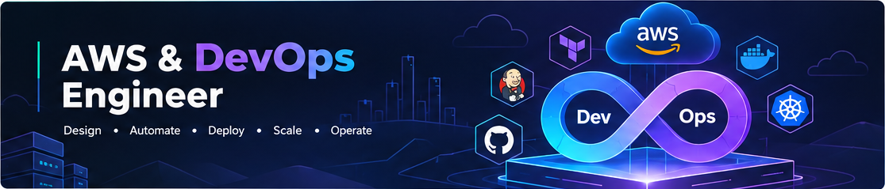

  

# Hi, I'm Gurumurthy Padala 👋

### Senior AWS DevOps Engineer | 8+ Years of Experience

**AWS · Azure · Kubernetes · Terraform · Docker · Jenkins · CI/CD · DevSecOps**

Building secure, scalable and highly available cloud platforms through automation, Infrastructure as Code and reliable delivery practices.

  
  
  

---

## 👨‍💻 About me

I'm a Senior AWS DevOps Engineer with **8+ years of experience** in cloud infrastructure, CI/CD automation and production operations. My work spans AWS and Azure environments, infrastructure provisioning, container platforms, release engineering, security integration and monitoring.

I enjoy making infrastructure repeatable, deployments dependable and operations easier to troubleshoot.

- ☁️ Design and manage cloud infrastructure on **AWS and Microsoft Azure**.
- 🏗️ Provision infrastructure using **Terraform, Ansible and AWS CloudFormation**.
- 🔁 Build and maintain CI/CD workflows with **Jenkins, GitHub Actions and GitLab CI/CD**.
- 📦 Build container images and operate workloads with **Docker, Kubernetes, EKS, AKS and Helm**.
- 🔐 Integrate security checks with **SonarQube, Trivy, IAM and RBAC**.
- 📊 Improve observability using **CloudWatch, Prometheus, Grafana, ELK Stack and Datadog**.
- 🐧 Automate operational tasks using **Python, Bash and Shell scripting**.

## 🧰 Technology stack

| Domain | Technologies |
|---|---|
| **Cloud** | AWS: EC2, VPC, IAM, S3, EBS, EFS, RDS, ECR, ECS, EKS, ELB/ALB, Auto Scaling, Route 53, CloudWatch, Lambda, SNS, SQS, Systems Manager; Azure: Virtual Machines, VNet, NSG, Storage, Azure SQL, AKS, Azure Monitor, Log Analytics |
| **Infrastructure as Code** | Terraform, Ansible, AWS CloudFormation |
| **CI/CD & Release** | Jenkins, GitHub Actions, GitLab CI/CD, build and release management |
| **Containers & Orchestration** | Docker, Kubernetes, Amazon EKS, Azure AKS, Helm |
| **DevSecOps & Security** | SonarQube, Trivy, IAM, RBAC, HashiCorp Vault |
| **Monitoring & Observability** | CloudWatch, Azure Monitor, Prometheus, Grafana, Datadog, ELK Stack, Log Analytics |
| **Scripting & OS** | Python, Bash, Shell scripting, Linux (RHEL/CentOS/Ubuntu), Windows Server |
| **Build & Artifact Tools** | Maven, NPM, Nexus Repository |
| **Web & App Servers** | Nginx, Apache Tomcat |
| **Collaboration & ITSM** | Jira, Confluence, ServiceNow |

## 💼 Professional experience

| Role | Organization | Period |
|---|---|---|
| **Senior DevOps Engineer** | Tekreant India Private Limited · Hyderabad | Jan 2025 – Present |
| **DevOps Engineer** | Sysnet Global Solutions India Private Limited · Hyderabad | Jan 2018 – Sep 2024 |

## 🏗️ Selected project experience

### LabSquire — Healthcare platform
**Role:** Senior DevOps Engineer · **Feb 2025 – Present**

- Designed and maintained multi-stage Jenkins and GitHub Actions pipelines across Dev, QA, UAT and Production.
- Managed Terraform modules for AWS infrastructure including VPC, EC2, EKS, IAM, RDS, S3 and CloudWatch alarms.
- Built Docker images, managed private ECR and operated EKS workloads, including HPA, rolling updates and namespace-level RBAC.
- Developed Ansible playbooks for server provisioning, configuration and deployment automation; the resume records a **60% reduction in manual deployment effort**.
- Integrated SonarQube static analysis and Trivy image scanning with pipeline quality gates.
- Implemented monitoring and alerting with Prometheus, Grafana and CloudWatch; supported root-cause analysis and runbook creation.

**Technology:** AWS · EKS · Docker · Terraform · Ansible · Jenkins · GitHub Actions · SonarQube · Trivy · Prometheus · Grafana · Linux

### SecureInsure Portal — Enterprise insurance platform
**Role:** DevOps Engineer · **Jan 2023 – Sep 2024**

- Designed and maintained AWS infrastructure using VPC, EC2, RDS, S3, ELB, Route 53 and EKS.
- Developed Jenkins and GitHub Actions pipelines for automated deployments.
- Containerized applications with Docker and orchestrated workloads on Kubernetes (EKS).
- Automated infrastructure provisioning with Terraform and configuration management with Ansible.
- Integrated SonarQube and Trivy, and configured CloudWatch, Prometheus and Grafana monitoring.
- Supported production releases, incident resolution, high availability, disaster recovery and security controls.

### MicroGen — Cloud-native microservices platform
**Role:** DevOps Engineer · **Jul 2020 – Dec 2022**

- Deployed and managed microservices using Docker and Kubernetes (EKS).
- Built Jenkins and GitHub Actions CI/CD pipelines.
- Automated infrastructure provisioning and environment setup using Terraform.
- Managed IAM roles, security groups and access controls.
- Implemented observability using Prometheus, Grafana and CloudWatch.
- Supported production deployments, troubleshooting, performance tuning and infrastructure optimization.

### MobileLabXpress — Mobile laboratory management application
**Role:** Software Engineer · **Jan 2018 – Jun 2020**

- Provisioned AWS infrastructure including EC2, VPC, S3, IAM and RDS.
- Administered Linux servers, including user management, patching, performance tuning and troubleshooting.
- Configured Jenkins pipelines for application build, deployment and release.
- Built and deployed Docker containers and managed Git repositories.
- Used CloudWatch and Azure Monitor for infrastructure and application monitoring.
- Created Shell scripts for routine administration, deployment and maintenance automation.

## 📌 Featured repositories

A few public repositories from my GitHub profile:

| Repository | Focus |
|---|---|
| [terraform-aws-ec2-webapp](https://github.com/awslinuxdevops/terraform-aws-ec2-webapp) | AWS infrastructure provisioning with Terraform |
| [terraform-aws-infra](https://github.com/awslinuxdevops/terraform-aws-infra) | Terraform infrastructure build |
| [jenkins-maven-java-cicd](https://github.com/awslinuxdevops/jenkins-maven-java-cicd) | Jenkins, Maven and Java CI/CD |
| [threetier-application](https://github.com/awslinuxdevops/threetier-application) | Three-tier application deployment |
| [Automation-with-Shell-Scripting](https://github.com/awslinuxdevops/Automation-with-Shell-Scripting) | Shell scripting and automation |
| [docker-labpad](https://github.com/awslinuxdevops/docker-labpad) | Docker training notes and hands-on learning |

## 🔄 Delivery approach

`Plan` → `Code` → `Review` → `Build` → `Test` → `Scan` → `Deploy` → `Monitor`

I focus on version-controlled infrastructure, reviewed changes, automated quality and security checks, repeatable deployments, production support and continuous improvement.

## 📈 GitHub stats

---

### 🤝 Let's connect and build reliable cloud platforms

**Gurumurthy Padala · Senior AWS DevOps Engineer · Hyderabad, India**

*Design. Automate. Secure. Deploy. Improve.*

